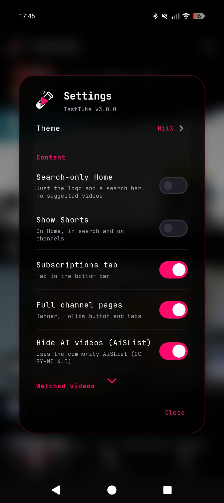
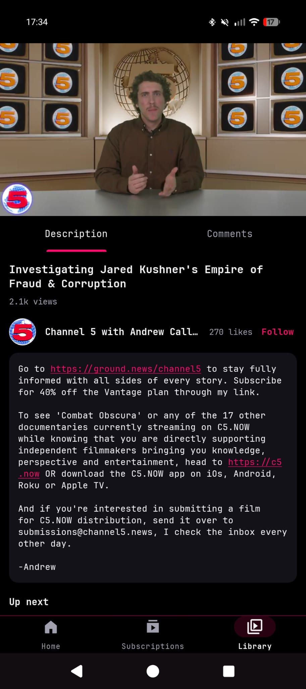
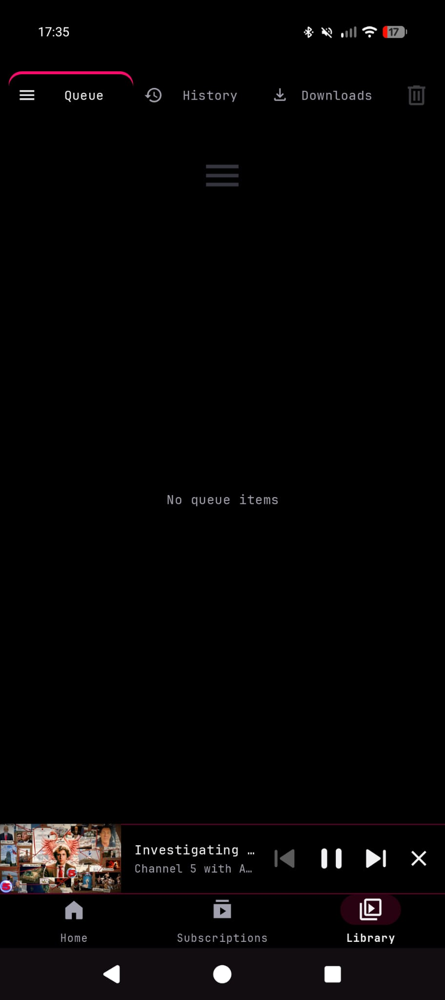

in a world full of excess we give you 5 mb of simplicity 

TestTube is an ad-free YouTube client for Android. No account needed: Home, search, subscriptions, queue and history all work without logging in. Signing in is optional and only used if you want your own YouTube subscriptions.

Requires Android 8.0 (API 26) or later.

> Fork: [dwicao/testtube](https://github.com/dwicao/testtube) — hardened + self-updating build of [techniixdotcom/testtube](https://github.com/techniixdotcom/testtube). See [Why this fork?](#why-this-fork) below. APKs: https://github.com/dwicao/testtube/releases

## Screenshots
**NiiX Theme**

## Features
* [x] **Light, Dark and NiiX theme** 
* [x] **Works with or without login** 
* [x] **Your YouTube subscriptions (if logged in)** 
* [x] **Home for discovering**
* [x] **Ad-free playback**
* [x] **Swipe a video right to add it to the queue**
* [x] **Sponsor-block**
* [x] **AI video block**
* [x] **Local queue support**
* [x] **Local history**
* [x] **Background & Picture-in-Picture support**
* [x] **Built-in video and queue downloader**
* [x] **Watched videos greyed out**
* [x] **Light on data**

## Why this fork?

Upstream is `techniixdotcom/testtube`. This fork (`dwicao/testtube`) keeps the same app and UI, but hardens it and ships its own signed releases with in-app updates:

* **Independent releases:** tags like `v3.0.15` build in GitHub Actions (`.github/workflows/release.yml`), sign with the public AOSP test key, and publish to https://github.com/dwicao/testtube/releases. The app checks `version.json` on `main` first, then the GitHub API, so it updates from this fork, not upstream. `versionCode` is auto-derived from the tag (`v3.0.15` → `30015`). `version.json` also carries broadcasts: `notice`/`noticeTag` (info dialog, shown once) and `minVersionCode` (update-required prompt that ignores the snooze) — edit them on `main` and commit to message all installs without a release. A scheduled extractor canary (`.github/workflows/upstream-canary.yml`, every 6h) extracts two stable videos with the vendored NewPipe code and auto-opens an `upstream-breakage` issue when YouTube-side changes break us.
* **Security:** login flag in EncryptedSharedPreferences (KeyStore, fallback private prefs) — cookies still in WebView SQLite by OS design, documented; login WebView URL guard fixed for API 24+ (allowlist), live-chat `videoId` validated + encoded, PoToken WebView locked down, `FileProvider` narrowed to `Download/TestTube/`, `https`-only `autoVerify` deep links, update APKs require SHA-256 + same-signer + versionCode, authed YouTube traffic is `no-store`, R8 obfuscation on, `useLegacyPackaging=false`. No hard cert pin (would brick on rotation) — TLS + hash + signer is the update trust.
* **Privacy (docs match code):** new Settings toggles — Personalize Home (off = generic discovery, no history sent), Skip sponsors (off = no SponsorBlock fetch) + per-category picker, Preload on mobile (off = details only, ~KBs), Prefer H264 (on = most compatible decoder), Allow HDR (off = forced SDR, fixes blue skin on Samsung). README now says what actually leaves the phone — shared visitor cookies, history-based Home discovery, SponsorBlock categories + 1h mem cache, AiSList ETag, `version.json`/GitHub update checks. Crash dialog can Share the report, otherwise everything stays on-device. Third hidden BotGuard WebView documented.
* **Stability:** no more leaked `ExoPlayer` on font/density change, single-player Shorts + cache prefetch (was 2 players), `DownloadService` stops itself + demotes stale `RUNNING→PAUSED` + throttled progress writes + capped history (500) + `Call.cancel()` on pause/cancel, pause/resume generation token, HDR playback errors fall straight back to SDR muxed, `VideoCacheEvictor` synchronized, `FloatingWindow.release()` (velocity + touch + layout), `MiniBar.release()`, `Controller.release()`, `QueueAdapter` diff off main thread, PiP dual overload, media-session detach, Shorts standby preload skipped on mobile unless opted in.
* **Performance/data:** live HLS/DASH via shared OkHttp pool (HTTP/2 reuse); VOD stays on `YoutubeHttpDataSource` for range/rn/cookies. No warmup/preload on mobile data unless Preload-on-mobile is on, `AvatarCache`/`FeedAdapter` LRU instead of wipe, manifest cache 500→100, feed thumbs `hqdefault` + `override(854,480)`, Shorts capped 720p, More options Download shows progress if already downloading.

Test-key note: CI signs with the well-known AOSP `testkey` (password `android`). Anyone has that key, so treat these APKs as test builds — Android still blocks cross-signer updates.

## How it works

Almost everything is native: the player, Home, Subscriptions, search, channel and playlist pages (every channel tab), History, the queue, the screen under the video (Description/Comments tabs, suggestions) and the downloader are drawn by the app itself and get their data directly from YouTube through the NewPipe extractor. This is faster, smoother and fully under our control.

Only two small web views are left: the Google sign-in page, and the live chat of live streams. There is no YouTube website layer, no injected scripts and no page bridge. A third hidden offline BotGuard page (network blocked, no cookies sent) mints PO tokens for playback.

Subscriptions come from one of two places. By default the app shows the latest videos of the channels you follow, read from YouTube's public channel feeds, so no account is involved. "Use my YouTube account" switches to your account's own subscriptions.

## Privacy

* No analytics, crash reporting or ads in the app. History, queue and followed channels stay on the phone, and backups are off. Crash logs stay in the app's files (cleared after one restart) and are never uploaded.
* YouTube and Google still see your IP address and the videos you watch, as with any YouTube client. Sign-in, live chat and extractor requests share one visitor (cookies), like a single browser tab. Login flag is encrypted (KeyStore); cookies stay in WebView storage by OS design.
* Home discovery (signed out) is built from your recent local history: up to 4 video IDs and 2 titles are sent as YouTube search/next lookups. Turn off Settings → Personalize Home for generic discovery; clearing history stops it too.
* SponsorBlock: the app sends the first 4 characters of a hash of the video ID + your enabled categories + IP to sponsor.ajay.app. Cached in memory for 1h, never in the shared HTTP cache. Turn off Settings → Skip sponsors to disable. There are no dislike-count lookups.
* Hide AI videos (off by default): when switched on, the app downloads the community AiSList from raw.githubusercontent.com once a day (If-None-Match). Only IP + User-Agent + ETag are visible, no IDs or cookies.
* Update checks: the app first asks raw.githubusercontent.com/dwicao/testtube/main/version.json (no API limits), then falls back to api.github.com/repos/dwicao/testtube/releases. Check runs 5 seconds after start, including test versions if “Pre-releases” is on. Updates are downloaded from github.com/dwicao/testtube with mandatory SHA-256 + same-signer + versionCode checks. Only IP + `User-Agent: TestTube` are visible. Switch off by tapping the TestTube logo on Home → Updates → “Check for updates automatically”.

## Releases (this fork: dwicao/testtube)

* APKs: https://github.com/dwicao/testtube/releases — e.g. `testtube3.0.15.apk` + `version.json`.
* Tag: `git tag v3.0.15 && git push origin v3.0.15` — `.github/workflows/release.yml` builds `assembleRelease`, signs with the public AOSP test key, creates the GitHub Release, uploads the APK, and updates `version.json` on `main` so the app auto-updates. Pushes to `main` run `.github/workflows/check.yml` (debug build + unit tests + lint).
* Local: `./BUILD.sh` (own key in `~/.testtube/signing`). CI key is the well-known AOSP `testkey` (password `android`) — fine for testing, not for private accounts: anyone can forge updates signed with it, so the app still enforces same-signer installs.

## License

GPL-3.0. NewPipe Extractor is GPL-3.0-or-later.

Peace and Love

by

techniix / cuteLiLi / QuacK / decoi
